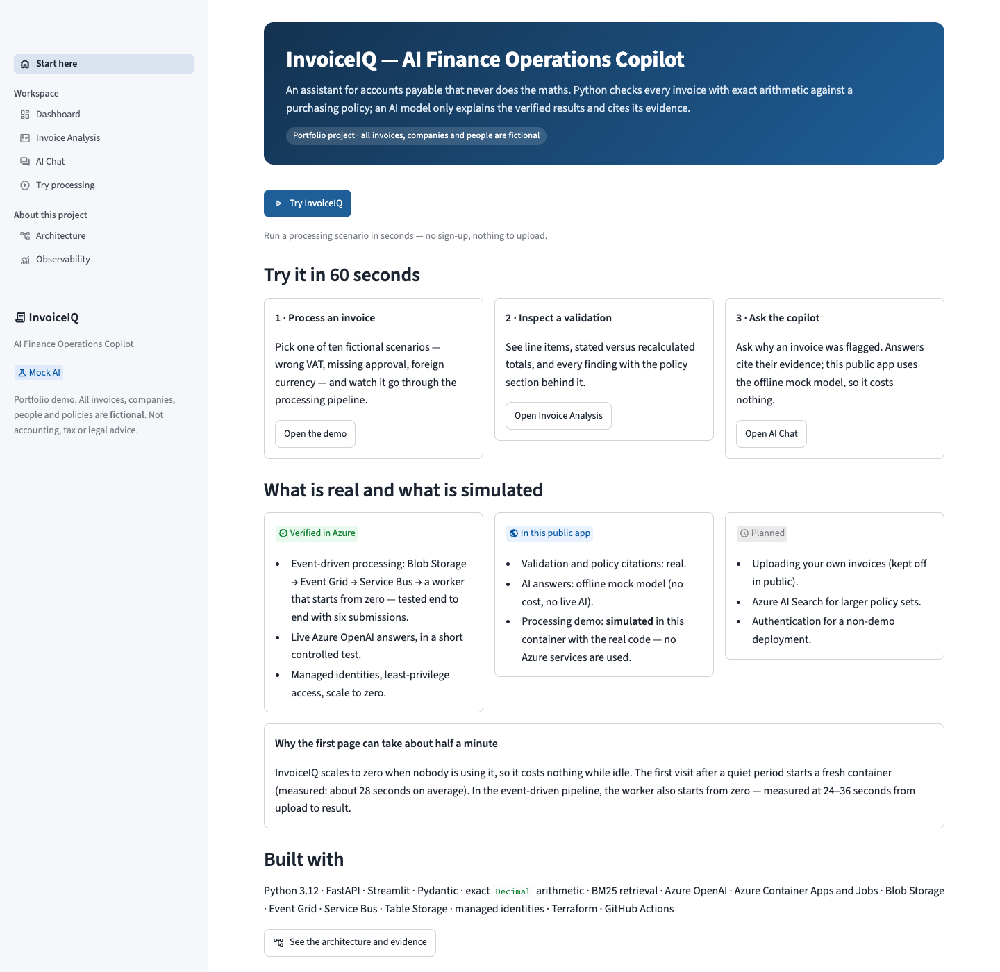
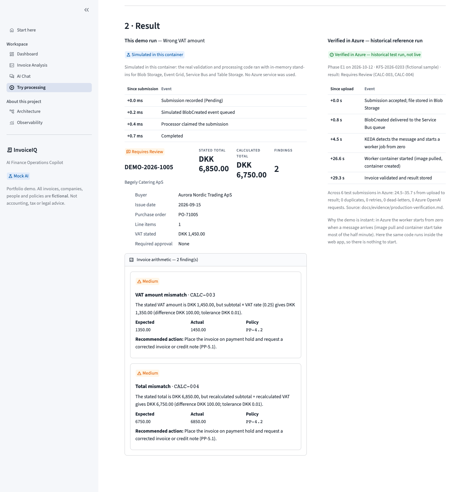
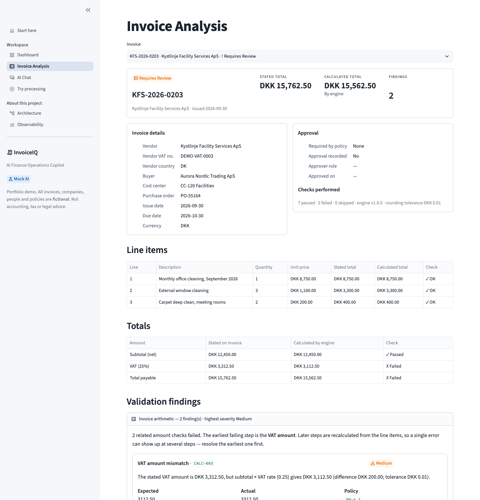
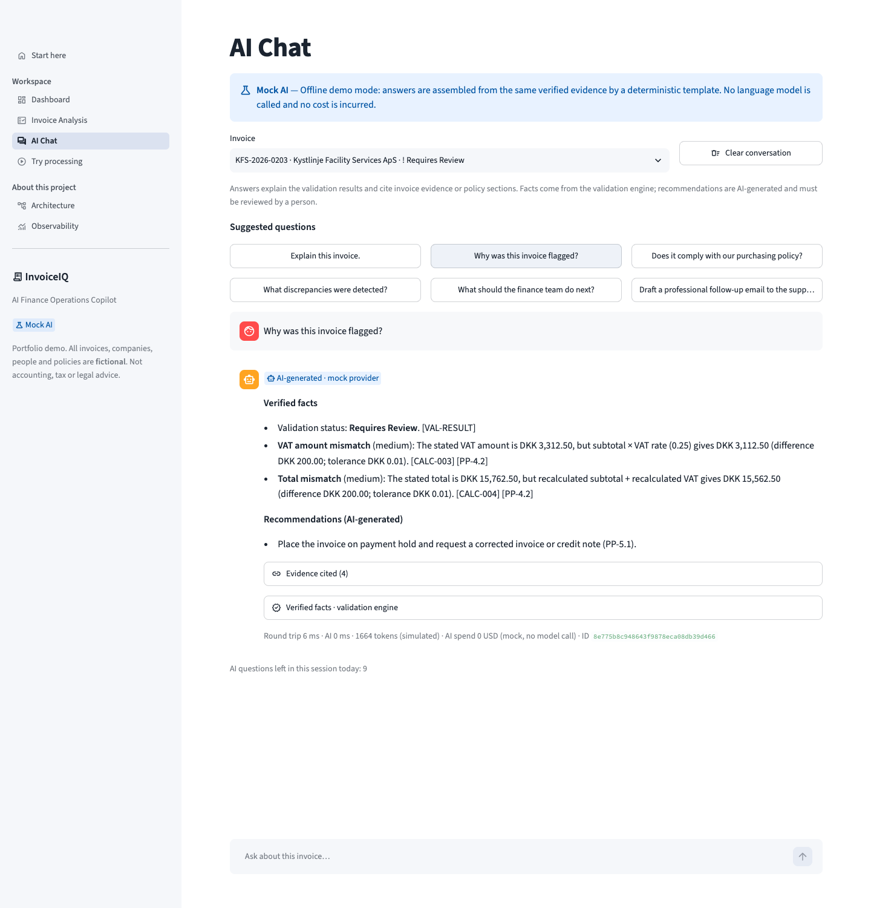
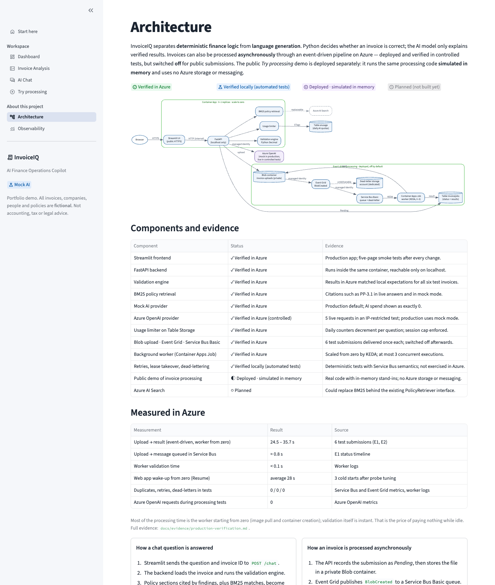
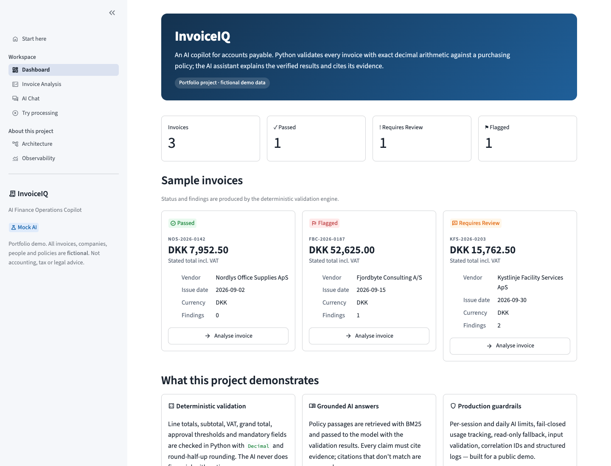
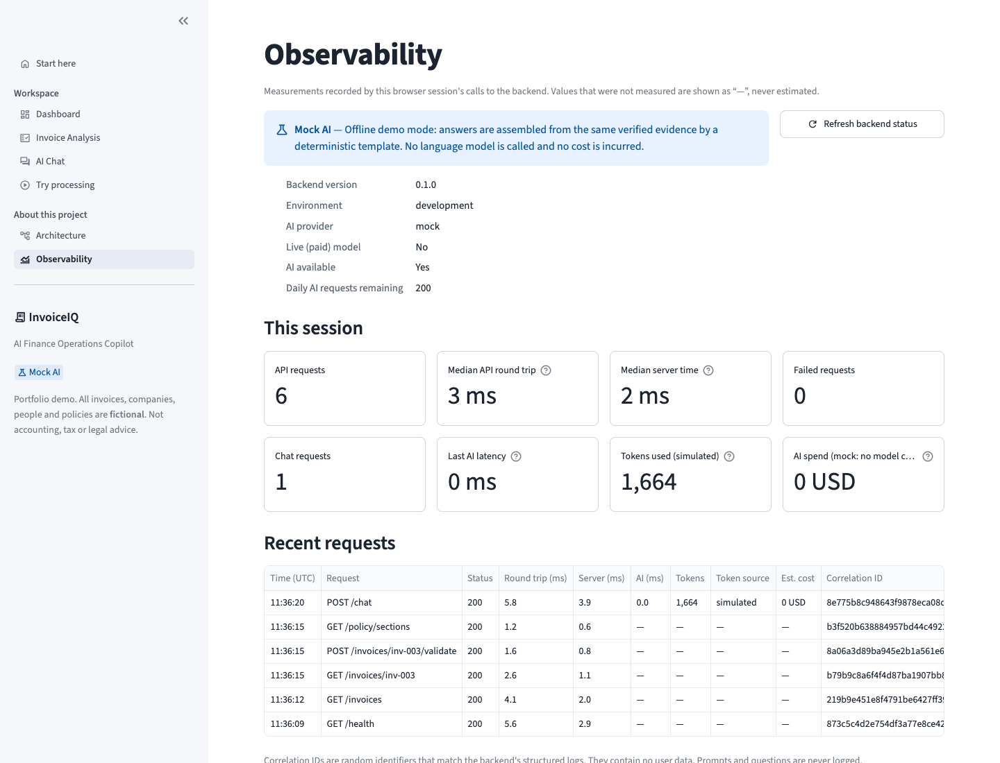
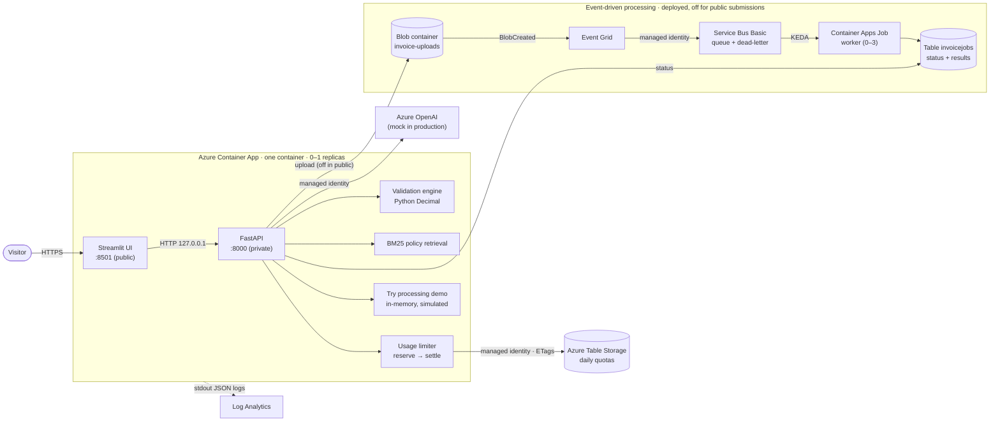
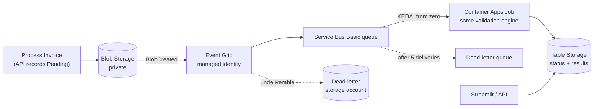

# InvoiceIQ — AI Finance Operations Copilot

**An AI assistant for accounts payable that never does the maths.** Python checks every invoice
with exact decimal arithmetic against a purchasing policy; a language model only explains the
verified results, cites the policy behind them and drafts next steps for a person to review.
Invoices can also be processed by an event-driven pipeline on Azure that scales to zero.

> **Portfolio project.** All invoices, companies, people and policies are **fictional**. The
> rules (25% VAT, a DKK 20,000 approval threshold, …) are demo rules, not accounting, tax or
> legal advice.

**Live app:** <https://ca-invoiceiq-dbmr0.bravewater-5e6a1283.swedencentral.azurecontainerapps.io>

> **The first visit can take about 30 seconds.** The app scales to zero when nobody is using it,
> so it costs nothing while idle; a fresh container starts on the first request (measured
> average: 28 s). After that, pages respond immediately.



## 60-second tour

1. **Try processing** — click *Try InvoiceIQ*, pick one of ten fictional invoices (wrong VAT,
   missing approval, foreign currency, …) and run it. The result shows the processing steps, the
   findings and — in a separate panel — a historical run of the real Azure pipeline with its
   measured timings. The demo is **simulated** inside the web app; see below.
2. **Invoice Analysis** — open a flagged invoice: line items, stated versus recalculated totals,
   and each finding with the policy section behind it.
3. **AI Chat** — ask "Why was this invoice flagged?". The answer cites its evidence, and a
   separate *verified facts* panel comes from the validation engine, never from the model. The
   public app uses an offline mock model, so it costs nothing.

## What this project demonstrates

- **Deterministic logic, AI for language only.** Twelve validation rules in Python `Decimal`;
  the model explains verified results and its citations are checked after generation.
- **Event-driven processing on Azure, verified end to end.** Blob Storage → Event Grid →
  Service Bus → a Container Apps Job started from zero by KEDA; idempotent result handling under
  at-least-once delivery. Tested with six submissions in Azure.
- **A safe public demo.** Visitors run predefined scenarios through the same processing code
  with in-memory stand-ins — no uploads, no Azure storage or messaging, clearly labelled.
- **Security by default.** Managed identities only, API and storage keys disabled, separate
  least-privilege identities for the web app, worker and autoscaler, escaped rendering of
  invoice text.
- **Cost awareness.** Scale to zero, Service Bus Basic, a reserve-and-settle AI budget that fails
  closed, and a mock AI provider for the public app.
- **Engineering discipline.** 526 automated tests (95% coverage), 24 Terraform plan tests,
  infrastructure as code, CI gates, and documented evidence instead of claims.

**Read more:** [architecture case study](docs/case-study.md) ·
[production verification evidence](docs/evidence/production-verification.md)

## What is real and what is simulated

| | In the public app | Evidence |
|---|---|---|
| Validation engine, policy citations, usage limiter | **Live** | Verified in Azure |
| AI answers | **Mock** model (no live AI) | Azure OpenAI verified in a controlled test (5 requests) |
| *Try processing* demo | **Deployed, simulated in memory** — uses no Blob Storage, Event Grid, Service Bus or Table Storage | Automated tests; production smoke test |
| Event-driven pipeline (Blob → Event Grid → Service Bus → worker) | **Deployed but off** for public submissions | Verified in Azure — 6 test submissions |
| Retries, lease takeover, dead-lettering | — | Automated tests only; not exercised in Azure |
| Uploading your own invoices, Azure AI Search, authentication | — | Planned, not implemented |

---

## Contents

[The problem](#the-business-problem) · [What it does](#what-it-does) ·
[Architecture](#architecture) · [Tech stack](#technology-stack) ·
[Status and evidence](#status-and-evidence) · [Run locally](#run-locally) ·
[Docker](#docker) · [Deploy to Azure](#deploy-to-azure-terraform) ·
[Security and cost controls](#security-and-cost-controls) · [Testing](#testing) ·
[Design decisions](#key-design-decisions-and-trade-offs) · [Limitations](#known-limitations) ·
[Event-driven processing](#event-driven-processing) · [Case study](docs/case-study.md) ·
[Evidence](docs/evidence/production-verification.md)

## The business problem

Accounts-payable teams check every supplier invoice before paying it: do the line items add up,
is the VAT right, was the purchase approved at the right level, are mandatory fields present?
The checks are repetitive, and mistakes are expensive — overpayments, missing approvals, audit
findings.

Large language models are good at *explaining* such issues and drafting supplier emails, but
they are **unreliable at arithmetic** and can invent facts. InvoiceIQ splits the job:

| Responsibility | Done by | Why |
|---|---|---|
| Totals, VAT, rounding, thresholds, required fields | Deterministic Python (`Decimal`) | Exact, testable, auditable |
| Finding relevant policy text | BM25 keyword retrieval | Cheap, transparent, citable section IDs |
| Explanations, recommendations, email drafts | Azure OpenAI | Natural language over **verified** evidence only |

## What it does

- **Start here** — what the project is, what to try, and what is real versus simulated.
- **Dashboard** — three fictional invoices with their status: *Passed*, *Flagged* or
  *Requires Review*.
- **Invoice Analysis** — line items, stated vs. recalculated totals, findings grouped by root
  cause (e.g. one VAT error that also makes the total wrong), and the policy text behind each.
- **AI Chat** — suggested questions, per-invoice chat history, cited evidence, and a separate
  "verified facts" panel produced by the validation engine, never by the model. Clear labels show
  whether an answer came from Azure OpenAI, the offline mock, or read-only mode.
- **Try processing** — ten predefined fictional scenarios that together exercise all twelve
  rules, run through the real processing code **simulated in memory**, shown next to a
  historical, verified Azure run.
- **Process Invoice** — submit a fictional invoice to the real event-driven pipeline. Deployed
  and verified, but **off** in the public app (see [Event-driven processing](#event-driven-processing)).
- **Architecture** — what is deployed, how each part was verified, measured numbers and
  security boundaries.
- **Observability** — real per-session latency, AI latency, token usage and estimated cost.

| Try processing | Invoice Analysis |
|---|---|
|  |  |

| AI Chat | Architecture |
|---|---|
|  |  |

| Dashboard | Observability |
|---|---|
|  |  |

The three sample invoices:

| Invoice | Scenario | Result |
|---|---|---|
| NOS-2026-0142 | Correct arithmetic, below the approval threshold | ✓ Passed |
| FBC-2026-0187 | DKK 42,100 net, above the DKK 20,000 threshold, no manager approval | ⚑ Flagged (`APR-001`) |
| KFS-2026-0203 | VAT stated as DKK 3,312.50; 25% of DKK 12,450.00 is DKK 3,112.50 | ! Requires Review (`CALC-003`, `CALC-004`) |

## Architecture



The *Try processing* demo runs inside the web container and never touches the event-driven
resources on the right.

**A chat question, step by step:** the API loads the invoice and validates it → retrieves the
policy sections cited by findings plus BM25 matches → **reserves** one request and an
upper-bound cost estimate in Table Storage (atomically, with ETags) → sends instructions,
evidence and the question to the model as separate messages → removes any citation not present
in the evidence → **settles** the reservation with actual token usage → returns the answer
together with verified facts built by Python.

If AI is disabled, over budget, or the limiter is unreachable, the app **fails closed** into a
read-only mode that still shows the verified validation results.

## Technology stack

| Area | Choice |
|---|---|
| Language / packaging | Python 3.12, `uv` (lockfile), `src/` layout |
| Backend | FastAPI, Pydantic v2 |
| Frontend | Streamlit (multipage, light enterprise theme) |
| AI | Azure OpenAI via the official OpenAI SDK (GA v1 endpoint), Entra ID auth; offline mock provider |
| Retrieval | BM25, implemented in ~100 lines (no vector DB) |
| Usage limiting | Azure Table Storage with ETag optimistic concurrency; SQLite/in-memory for local dev |
| Event-driven processing | Blob Storage, Event Grid (system topic, managed-identity delivery), Service Bus **Basic**, Container Apps Job scaled by KEDA |
| Container | Multi-stage Dockerfile, `tini` + Python supervisor, non-root |
| Infrastructure | Terraform (AzureRM 4.81 + AzAPI 2.13): Container Apps and Jobs, Azure OpenAI, Storage, Event Grid, Service Bus, Log Analytics, managed identities |
| CI/CD | GitHub Actions: ruff, pytest + Azurite, Terraform test, Docker smoke test; manual multi-arch image publishing; OIDC deploy (disabled) |
| Quality | pytest (526 tests, 95% coverage), ruff, `terraform test` (24 runs, mocked providers) |

## Status and evidence

**Verified in Azure** = observed in the production subscription; **verified locally** = covered by
automated tests; **simulated** = the real code with in-memory stand-ins; **planned** = not built.
Details and measurements: [docs/evidence/production-verification.md](docs/evidence/production-verification.md).

| Component | Status |
|---|---|
| Deterministic validation engine (12 rules) | ✅ Verified in Azure |
| BM25 policy retrieval with stable citations | ✅ Verified in Azure |
| FastAPI backend and Streamlit UI | ✅ Verified in Azure (Container Apps, scale to zero) |
| Mock AI provider | ✅ Verified in Azure — production default |
| Azure OpenAI provider (Entra ID, timeouts, bounded retries) | ✅ Verified in Azure in a controlled, IP-restricted test (5 requests); production stays in mock mode |
| Persistent usage limiter on Azure Table Storage | ✅ Verified in Azure |
| Event-driven processing (Blob → Event Grid → Service Bus Basic → Container Apps Job) | ✅ Verified in Azure — 6 test submissions; **off** for public submissions |
| Retries, lease takeover, lock renewal, dead-lettering | 🧪 Verified locally (automated tests); not exercised in Azure |
| Public *Try processing* demo (`DEMO_MODE_ENABLED`) | ◐ Deployed — **simulated** in memory; uses no Azure storage or messaging |
| Terraform (incl. event-processing resources) | ✅ Applied; plan reports no drift |
| CI, image publishing (GHCR, amd64 + arm64) | ✅ In use |
| Deploy workflow (OIDC) | ✅ Written — **disabled** until credentials are reviewed |
| Uploads for visitors, Azure AI Search, Document Intelligence, authentication | ⏳ Planned |

## Run locally

Requires Python 3.12 and [uv](https://docs.astral.sh/uv/). No Azure account needed — the mock
AI provider is the default.

```bash
uv sync
uv run pytest

# Terminal 1 — FastAPI (API docs at http://127.0.0.1:8000/docs)
DEMO_MODE_ENABLED=true uv run uvicorn invoiceiq.api.main:app_factory --factory --reload

# Terminal 2 — Streamlit (http://localhost:8501)
uv run streamlit run src/invoiceiq/frontend/app.py
```

Configuration is environment-driven; see [.env.example](.env.example). To use a real Azure
OpenAI deployment locally, set `AI_PROVIDER=azure_openai`, `AZURE_OPENAI_ENDPOINT` and
`AZURE_OPENAI_DEPLOYMENT`, and sign in with `az login` (Entra ID; no API key needed).

## Docker

```bash
docker compose up --build        # → http://localhost:8501
```

- One image runs both services under a small supervisor: FastAPI on `127.0.0.1:8000` (not
  reachable from outside the container), Streamlit on `0.0.0.0:8501`.
- Runs as non-root user `10001`; Compose also uses a read-only filesystem, dropped
  capabilities and `no-new-privileges`.
- Health check covers both services; SIGTERM shuts both down gracefully (≈1 s).
- No credentials in the image. ~174 MB compressed (most of it is Streamlit's pandas/pyarrow).

Persistent limiter against the local storage emulator:

```bash
docker compose --profile azurite up --build
# with USAGE_STORE=azure_table and AZURE_TABLE_CONNECTION_STRING in .env (see .env.example)
```

## Deploy to Azure (Terraform)

> Deploying creates billable resources. Read
> [docs/deployment-readiness.md](docs/deployment-readiness.md) first (a historical
> pre-deployment review).

Terraform in [infra/terraform](infra/terraform) creates: resource group, Log Analytics
workspace, a Container Apps environment with only the serverless *Consumption* profile, the container app (0–1 replicas,
0.5 vCPU / 1 GiB, HTTPS ingress on 8501), Azure OpenAI account + model deployment (API keys
disabled), storage account (shared keys disabled) + `aiusage` table created through Azure Resource
Manager via AzAPI (no shared-key ACL call), a user-assigned managed
identity with two least-privilege role assignments, and optionally a budget alert and a GitHub
OIDC deploy identity.

1. **Choose a model and check availability and quota** — never assume them:
   ```bash
   az cognitiveservices model list -l swedencentral \
     --query "[?model.name=='<model>'].{version:model.version, skus:model.skus[].name}" -o table
   az cognitiveservices usage list -l swedencentral -o table
   ```
2. **Publish the image** with the manual *Publish image* workflow (GHCR, amd64 + arm64, full-SHA tag,
   only for commits whose CI passed) and copy the digest from the run summary.
3. `cp infra/terraform/terraform.tfvars.example infra/terraform/production.tfvars` and fill in the
   image, model, version and **real token prices** (Terraform refuses zero prices — the daily cost
   budget depends on them). `ai_provider` defaults to `mock`; set `azure_openai` to opt in to live
   answers. `worker_container_image` (optional, defaults to `container_image`) lets the web app and
   the worker job be rolled out independently. `demo_mode_enabled` shows the simulated demo.
4. ```bash
   cd infra/terraform
   terraform init
   terraform plan -var-file=production.tfvars -out tfplan   # review every resource
   terraform apply tfplan                                    # only after review
   ```
   The file is deliberately **not** called `terraform.tfvars`: Terraform would load that
   automatically, including in `terraform test`, where production values would hide the defaults
   the tests check. Without `-var-file`, a plan stops with *No value for required variable*.
5. Optional: set `github_repository` to create the OIDC deploy identity, then configure the
   repository variables listed at the top of [.github/workflows/deploy.yml](.github/workflows/deploy.yml).

Offline checks (no Azure credentials): `terraform validate` and `terraform test` (plan tests with
mocked providers).

**Event-driven processing** is created only with `event_processing_enabled = true` (requires the
`Microsoft.EventGrid` and `Microsoft.ServiceBus` resource providers), and exposed in the app only
with `async_processing_enabled = true`. Event Grid validates its managed identity when the
subscription is created, so on a first deployment create the dead-letter role assignment, wait
about 10 minutes, then create the subscription. A reusable compatibility test lives in
[infra/manual-tests/eventgrid-servicebus-basic](infra/manual-tests/eventgrid-servicebus-basic).

## Security and cost controls

**AI usage (public demo protection)**

- Per-session limit (default 10 questions/day), global daily request limit (200) and a daily
  **estimated-cost budget** (default USD 1.00).
- Each call **reserves** an upper-bound estimate (prompt ÷ 3 characters per token + the full
  output allowance) before calling the model and **settles** with the provider-reported usage
  afterwards. Timeouts, server errors and missing usage data are charged at the estimate.
- Counters live in Azure Table Storage, shared by all replicas and durable across scale-to-zero;
  ETag-conditioned transactions make concurrent reservations safe.
- **Fail closed:** in production, live AI is refused unless the persistent limiter is reachable
  and model prices are configured. Output tokens, input size, question length and request
  duration are all bounded.
- Azure OpenAI's tokens-per-minute quota is a *throughput* limit, not a spending cap; the
  application budget is what bounds cost. A free Azure budget alert can notify (it does not stop
  spending).

**Application security**

- No secrets anywhere: managed identity for Azure OpenAI and Table Storage; API keys and storage
  shared keys are disabled in Terraform. GitHub deploys use OIDC federation.
- Least privilege: every role assignment is scoped to a single resource. The web app, the worker
  and the KEDA scaler have **separate** managed identities; the worker has no Azure OpenAI role,
  and the scaler identity cannot be used by container code. Event Grid delivers and dead-letters
  with its own identity (dead-letters go to a dedicated storage account).
- Prompt-injection resistance: instructions, evidence (JSON, labelled as data) and the question
  are separate messages; look-alike tags are stripped; citations are verified after generation;
  the facts panel never comes from the model.
- Safe errors: no stack traces or submitted values in responses; correlation IDs link the UI to
  structured JSON logs; prompts and questions are never logged.
- Public demo: catalog scenario IDs only (no file or JSON upload path), bounded memory, and no
  Azure clients — tests fail if demo code constructs one.
- Invoice upload (event-driven mode only, off in public): JSON only, ≤ 64 KB, schema-validated,
  separate daily allowance, private storage, 7-day retention; invoice-supplied text is rendered as
  escaped text, never as Markdown or HTML (security regression tests).
- Other input is validated with Pydantic and length limits.

## Testing

| Suite | Tests | What it covers |
|---|---:|---|
| Unit | 178 | Every validation rule incl. boundaries and rounding, BM25, prompts, citations, providers (fake SDK client), cost accounting, supervisor |
| Processing | 112 | Event parsing, Service Bus peek-lock semantics, leases, duplicates, lock expiry, crash recovery, retries, dead-lettering, concurrency; the public demo's catalog, bounds and isolation from Azure |
| API | 69 | All endpoints incl. submissions and demo, feature-flag matrix, error envelopes, correlation IDs, read-only modes |
| Frontend | 113 | Presentation logic, API client, every Streamlit page via `AppTest`, navigation by feature flag, escaping of untrusted invoice text |
| Integration | 54 | Usage and submission stores and Blob Storage on **Azurite**: ETags, atomic commits, concurrency, end-to-end worker path |
| Terraform | 24 | Plan tests with mocked providers: scaling, keys disabled, least-privilege role scopes, Service Bus Basic, private containers, platform-only scaler identity, feature flags, safe defaults, independent web/worker images |

```bash
uv run pytest --cov=invoiceiq        # 526 passed, 95% line coverage
# Azurite tests run when the emulator is up (CI requires it):
docker run -d -p 127.0.0.1:10000:10000 -p 127.0.0.1:10002:10002 \
  mcr.microsoft.com/azure-storage/azurite:3.35.0 \
  azurite --blobHost 0.0.0.0 --tableHost 0.0.0.0 --skipApiVersionCheck --loose
cd infra/terraform && terraform init -backend=false && terraform test
```

No automated test calls Azure or a live model. Production behaviour was verified separately,
in controlled and documented runs — see the [evidence](docs/evidence/production-verification.md).

## Key design decisions and trade-offs

The [case study](docs/case-study.md) explains the main decisions in more depth.

- **One container for both processes** keeps hosting at one scale-to-zero app. The trade-off is
  coupled scaling and a custom supervisor; splitting them is easy later because the UI only talks
  HTTP to the API.
- **BM25 instead of embeddings:** the policy is ~20 short sections; keyword retrieval is free,
  deterministic and easy to explain. The `PolicyRetriever` interface allows Azure AI Search later.
- **Findings cascade by design:** expected amounts always derive from quantity × unit price, so a
  wrong line also shows up in the subtotal, VAT and total. The UI groups these and points at the
  earliest failing step.
- **Approval thresholds use the recalculated net amount**, so a supplier cannot dodge approval by
  understating the subtotal.
- **Conservative cost accounting** over-counts when the outcome is ambiguous; the demo may go
  read-only slightly early, but it cannot overspend.
- **A simulated public demo instead of public uploads:** visitors see the processing flow
  without any path to write to Azure storage or queues.

## Known limitations

- The public app runs with the mock provider. Live Azure OpenAI was verified only in a short,
  IP-restricted test (5 requests).
- Event-driven processing is verified with 6 test submissions but switched off for public
  submissions. Retries, lease takeover and dead-lettering are covered by automated tests, not yet
  exercised in Azure. Processing from upload to result takes 24.5–35.7 s, almost all of it the
  worker starting from zero.
- The *Try processing* demo is a simulation: its millisecond timings are not representative of
  Azure, which is why the measured Azure run is shown beside it.
- The processing demo's daily allowances live in memory: best-effort, reset whenever the app
  scales to zero, and per replica. They protect memory and CPU, not a budget — the demo makes no
  paid calls.
- Per-session limits are per browser session; reloading starts a new session. The **global**
  request and cost caps are the hard limits.
- Streamlit holds a WebSocket per open tab, so an idle tab would keep the replica running. An
  **idle pause** (browser-side, configurable) pauses sessions after 15 min without interaction or
  5 min in a hidden tab, with a 60 s warning; chat history is restored on Resume in the same tab.
  Verified on Azure: the app scaled to zero ~6 min after a pause.
- Waking from zero takes ~25–35 s on Azure (measured average 28 s: replica scheduling, image
  pull, container creation, ingress routing); the app itself starts in ~2–3 s. Resume shows a
  "Starting InvoiceIQ" screen meanwhile; a first visit to the URL shows the browser's own loading
  indicator.
- Observability is per browser session; Azure Monitor dashboards are not yet built.
- Mock answers are templates; only the live model writes free-form text.
- Fictional data only; no authentication, no public uploads, no real financial integrations.

## Event-driven processing

Chat and analysis are **synchronous**. Real accounts-payable teams receive invoices continuously,
so ingestion can also run **asynchronously** — deployed on Azure and verified in controlled tests,
off for public submissions:



- **At-least-once delivery, idempotent processing.** Messages can arrive more than once. The
  worker claims each submission with a lease (ETag compare-and-set), never completes a message
  while another worker holds the lease, and stores the result **before** completing the message,
  so a redelivered message finds the stored result instead of producing a second one. Transient
  failures retry and then dead-letter with a visible status. (Duplicate, retry and dead-letter
  paths are covered by automated tests; the Azure runs saw none.)
- **Measured on Azure** (6 test submissions): upload to result **24.5–35.7 s**; message queued
  ≈ 0.8 s after upload; validation < 0.1 s. Almost all of the time is the worker starting from
  zero — the trade-off for paying nothing while idle.
- **Concurrency:** three simultaneous submissions started three overlapping executions (the
  configured maximum); the first one drained all three messages, the other two found nothing.
  Correct, slightly wasteful under bursts.
- **Cost:** no fixed monthly charges (Service Bus Basic, storage, Event Grid at this scale);
  estimated DKK 0.1–0.2/month while idle.

Full write-up, including the Event Grid dead-letter authorization finding:
[docs/evidence/production-verification.md](docs/evidence/production-verification.md) and
[docs/design/async-invoice-processing.md](docs/design/async-invoice-processing.md).

### Processing modes and feature flags

| Setting | Effect |
|---|---|
| neither flag (default) | No processing endpoints; `/submissions` and `/demo` answer 404 `feature_disabled` |
| `DEMO_MODE_ENABLED=true` (public app) | **Simulated** demo: `/demo/scenarios`, `/demo/runs`, `/demo/reference` and the *Try processing* page. Catalog scenarios only, in memory, bounded (200 runs, 1 h expiry). Never constructs an Azure client. Its daily allowances are **process-local and best-effort**: they reset when the replica restarts or scales to zero and are not shared between replicas. |
| `ASYNC_PROCESSING_ENABLED=true` | Live processing: `/submissions` and the *Process Invoice* page. With `SUBMISSION_BACKEND=azure` this uses Blob Storage, Service Bus and Table Storage — reserved for protected, non-public use. |

The two flags are independent; the public configuration is demo on, live processing off.

## Repository layout

```
src/invoiceiq/
  core/        validation engine, invoice service, BM25 retriever, usage limiter (no web/AI imports)
  ai/          evidence, prompts, providers (mock + Azure OpenAI), chat orchestration
  processing/  submissions, Event Grid parsing, Service Bus access, idempotent worker logic,
               simulated public demo (demo.py)
  worker.py    entry point of the Container Apps Job (no AI imports)
  api/         FastAPI app, routes, schemas, middleware
  frontend/    Streamlit app, views/, API client, presentation helpers
  storage/     Azure Table Storage usage store
  runtime/     container supervisor and health check
data/          fictional invoices, purchasing policy, demo scenarios, verified reference run
infra/terraform/   Azure infrastructure + plan tests
infra/manual-tests/  isolated Event Grid → Service Bus compatibility test
docs/          case study, design notes, production evidence, deployment readiness review, screenshots
```
