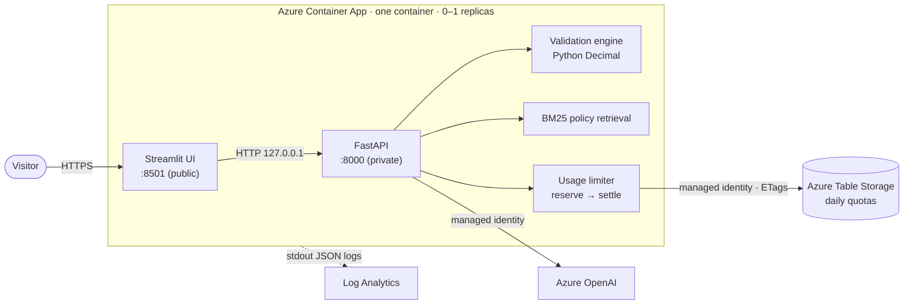
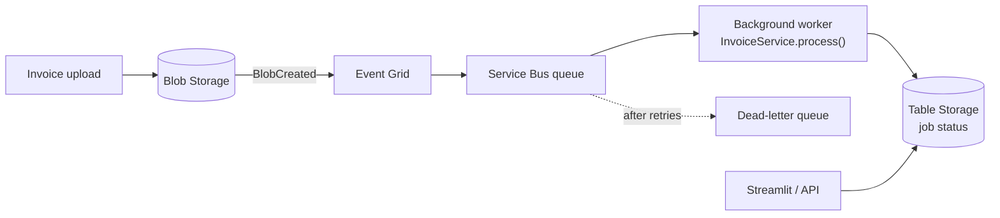

# InvoiceIQ — AI Finance Operations Copilot

**An AI assistant for accounts payable that never does the maths.** Python validates every
invoice with exact decimal arithmetic against a purchasing policy; a language model then explains
the verified results, cites its evidence, and drafts next steps for a person to review.

> **Portfolio project.** All invoices, companies, people and policies are **fictional**. The
> rules (25% VAT, a DKK 20,000 approval threshold, …) are demo rules, not accounting, tax or
> legal advice.


**Status:** Milestone 1 complete and deployment-ready. **Not yet deployed** — a public URL will
be added after the Azure deployment is approved.

---

## Contents

[The problem](#the-business-problem) · [What it does](#what-it-does) ·
[Architecture](#architecture) · [Tech stack](#technology-stack) ·
[Implemented vs planned](#implemented-vs-planned) · [Run locally](#run-locally) ·
[Docker](#docker) · [Deploy to Azure](#deploy-to-azure-terraform) ·
[Security and cost controls](#security-and-cost-controls) · [Testing](#testing) ·
[Design decisions](#key-design-decisions-and-trade-offs) · [Limitations](#known-limitations) ·
[Milestone 2](#milestone-2-event-driven-processing-planned)

## The business problem

Accounts-payable teams check every supplier invoice before paying it: do the line items add up,
is the VAT right, was the purchase approved at the right level, are mandatory fields present?
The checks are repetitive, and mistakes are expensive — overpayments, missing approvals, audit
findings.

Large language models are good at *explaining* such issues and drafting supplier emails, but
they are **unreliable at arithmetic** and can invent facts. InvoiceIQ splits the job:

| Responsibility | Done by | Why |
|---|---|---|
| Totals, VAT, rounding, thresholds, required fields | Deterministic Python (`Decimal`) | Exact, testable, auditable |
| Finding relevant policy text | BM25 keyword retrieval | Cheap, transparent, citable section IDs |
| Explanations, recommendations, email drafts | Azure OpenAI | Natural language over **verified** evidence only |

## What it does

- **Dashboard** — three fictional invoices with their status: *Passed*, *Flagged* or
  *Requires Review*.
- **Invoice Analysis** — line items, stated vs. recalculated totals, findings grouped by root
  cause (e.g. one VAT error that also makes the total wrong), and the policy text behind each.
- **AI Chat** — suggested questions, per-invoice chat history, cited evidence, and a separate
  "verified facts" panel produced by the validation engine, never by the model. Clear labels show
  whether an answer came from Azure OpenAI, the offline mock, or read-only mode.
- **Architecture** — what is built now and what is planned.
- **Observability** — real per-session latency, AI latency, token usage and estimated cost.

| Invoice Analysis | AI Chat |
|---|---|
|  |  |

| Architecture | Observability |
|---|---|
|  |  |

The three sample invoices:

| Invoice | Scenario | Result |
|---|---|---|
| NOS-2026-0142 | Correct arithmetic, below the approval threshold | ✓ Passed |
| FBC-2026-0187 | DKK 42,100 net, above the DKK 20,000 threshold, no manager approval | ⚑ Flagged (`APR-001`) |
| KFS-2026-0203 | VAT stated as DKK 3,312.50; 25% of DKK 12,450.00 is DKK 3,112.50 | ! Requires Review (`CALC-003`, `CALC-004`) |

## Architecture



**A chat question, step by step:** the API loads the invoice and validates it → retrieves the
policy sections cited by findings plus BM25 matches → **reserves** one request and an
upper-bound cost estimate in Table Storage (atomically, with ETags) → sends instructions,
evidence and the question to the model as separate messages → removes any citation not present
in the evidence → **settles** the reservation with actual token usage → returns the answer
together with verified facts built by Python.

If AI is disabled, over budget, or the limiter is unreachable, the app **fails closed** into a
read-only mode that still shows the verified validation results.

## Technology stack

| Area | Choice |
|---|---|
| Language / packaging | Python 3.12, `uv` (lockfile), `src/` layout |
| Backend | FastAPI, Pydantic v2 |
| Frontend | Streamlit (multipage, light enterprise theme) |
| AI | Azure OpenAI via the official OpenAI SDK (GA v1 endpoint), Entra ID auth; offline mock provider |
| Retrieval | BM25, implemented in ~100 lines (no vector DB) |
| Usage limiting | Azure Table Storage with ETag optimistic concurrency; SQLite/in-memory for local dev |
| Container | Multi-stage Dockerfile, `tini` + Python supervisor, non-root |
| Infrastructure | Terraform (AzureRM 4.81): Container Apps, Azure OpenAI, Storage, Log Analytics, managed identity |
| CI/CD | GitHub Actions: ruff, pytest + Azurite, Terraform test, Docker smoke test; OIDC deploy (disabled) |
| Quality | pytest (282 tests, 95% coverage), ruff, `terraform test` with mocked providers |

## Implemented vs planned

| Component | Status |
|---|---|
| Deterministic validation engine (12 rules) | ✅ Implemented |
| BM25 policy retrieval with stable citations | ✅ Implemented |
| FastAPI backend (health, invoices, validate, chat, policy) | ✅ Implemented |
| Streamlit UI (5 pages) | ✅ Implemented |
| Mock AI provider (offline, deterministic) | ✅ Implemented |
| Azure OpenAI provider (Entra ID, timeouts, bounded retries) | ✅ Implemented — tested with a fake client, **not yet called live** |
| Persistent usage limiter on Azure Table Storage | ✅ Implemented — tested on Azurite, **not yet on Azure** |
| Docker image + Compose | ✅ Implemented and verified locally |
| Terraform | ✅ Written, validated and plan-tested — **not applied** |
| CI workflow | ✅ Written and linted (`actionlint`) — runs once pushed to GitHub |
| Deploy workflow (OIDC) | ✅ Written — **disabled** until credentials are reviewed |
| Publish-image workflow (GHCR) | ✅ Manual; publishes only commits whose CI passed |
| Event Grid, Service Bus, Blob ingestion, background worker | ⏳ Planned (Milestone 2) |
| Azure AI Search, Document Intelligence, authentication | ⏳ Planned (later milestones) |

## Run locally

Requires Python 3.12 and [uv](https://docs.astral.sh/uv/). No Azure account needed — the mock
AI provider is the default.

```bash
uv sync
uv run pytest

# Terminal 1 — FastAPI (API docs at http://127.0.0.1:8000/docs)
uv run uvicorn invoiceiq.api.main:app_factory --factory --reload

# Terminal 2 — Streamlit (http://localhost:8501)
uv run streamlit run src/invoiceiq/frontend/app.py
```

Configuration is environment-driven; see [.env.example](.env.example). To use a real Azure
OpenAI deployment locally, set `AI_PROVIDER=azure_openai`, `AZURE_OPENAI_ENDPOINT` and
`AZURE_OPENAI_DEPLOYMENT`, and sign in with `az login` (Entra ID; no API key needed).

## Docker

```bash
docker compose up --build        # → http://localhost:8501
```

- One image runs both services under a small supervisor: FastAPI on `127.0.0.1:8000` (not
  reachable from outside the container), Streamlit on `0.0.0.0:8501`.
- Runs as non-root user `10001`; Compose also uses a read-only filesystem, dropped
  capabilities and `no-new-privileges`.
- Health check covers both services; SIGTERM shuts both down gracefully (≈1 s).
- No credentials in the image. ~174 MB compressed (most of it is Streamlit's pandas/pyarrow).

Persistent limiter against the local storage emulator:

```bash
docker compose --profile azurite up --build
# with USAGE_STORE=azure_table and AZURE_TABLE_CONNECTION_STRING in .env (see .env.example)
```

## Deploy to Azure (Terraform)

> Deploying creates billable resources. Read
> [docs/deployment-readiness.md](docs/deployment-readiness.md) first.

Terraform in [infra/terraform](infra/terraform) creates: resource group, Log Analytics
workspace, consumption-only Container Apps environment, the container app (0–1 replicas,
0.5 vCPU / 1 GiB, HTTPS ingress on 8501), Azure OpenAI account + model deployment (API keys
disabled), storage account + `aiusage` table (shared keys disabled), a user-assigned managed
identity with two least-privilege role assignments, and optionally a budget alert and a GitHub
OIDC deploy identity.

1. **Choose a model and check availability and quota** — never assume them:
   ```bash
   az cognitiveservices model list -l swedencentral \
     --query "[?model.name=='<model>'].{version:model.version, skus:model.skus[].name}" -o table
   az cognitiveservices usage list -l swedencentral -o table
   ```
2. **Publish the image** with the manual *Publish image* workflow (GHCR, amd64 + arm64, full-SHA tag,
   only for commits whose CI passed) and copy the digest from the run summary.
3. `cp infra/terraform/terraform.tfvars.example infra/terraform/terraform.tfvars` and fill in the
   image, model, version and **real token prices** (Terraform refuses zero prices — the daily cost
   budget depends on them).
4. ```bash
   cd infra/terraform
   terraform init
   terraform plan -out tfplan     # review every resource
   terraform apply tfplan         # only after review
   ```
5. Optional: set `github_repository` to create the OIDC deploy identity, then configure the
   repository variables listed at the top of [.github/workflows/deploy.yml](.github/workflows/deploy.yml).

Offline checks (no Azure credentials): `terraform validate` and `terraform test` (plan tests with
mocked providers).

## Security and cost controls

**AI usage (public demo protection)**

- Per-session limit (default 10 questions/day), global daily request limit (200) and a daily
  **estimated-cost budget** (default USD 1.00).
- Each call **reserves** an upper-bound estimate (prompt ÷ 3 characters per token + the full
  output allowance) before calling the model and **settles** with the provider-reported usage
  afterwards. Timeouts, server errors and missing usage data are charged at the estimate.
- Counters live in Azure Table Storage, shared by all replicas and durable across scale-to-zero;
  ETag-conditioned transactions make concurrent reservations safe.
- **Fail closed:** in production, live AI is refused unless the persistent limiter is reachable
  and model prices are configured. Output tokens, input size, question length and request
  duration are all bounded.
- Azure OpenAI's tokens-per-minute quota is a *throughput* limit, not a spending cap; the
  application budget is what bounds cost. A free Azure budget alert can notify (it does not stop
  spending).

**Application security**

- No secrets anywhere: managed identity for Azure OpenAI and Table Storage; API keys and storage
  shared keys are disabled in Terraform. GitHub deploys use OIDC federation.
- Least privilege: *Cognitive Services OpenAI User* on the AI account and *Storage Table Data
  Contributor* on the one table.
- Prompt-injection resistance: instructions, evidence (JSON, labelled as data) and the question
  are separate messages; look-alike tags are stripped; citations are verified after generation;
  the facts panel never comes from the model.
- Safe errors: no stack traces or submitted values in responses; correlation IDs link the UI to
  structured JSON logs; prompts and questions are never logged.
- No file uploads; input validated with Pydantic and length limits.

## Testing

| Suite | Tests | What it covers |
|---|---:|---|
| Unit | 166 | Every validation rule incl. boundaries and rounding, BM25, prompts, citations, providers (fake SDK client), cost accounting, supervisor |
| API | 29 | All endpoints, error envelopes, correlation IDs, read-only modes |
| Frontend | 47 | Presentation logic, API client, every Streamlit page via `AppTest` against the real API |
| Integration | 40 | Usage-store contract on memory, SQLite and **Azure Table (Azurite)**: ETags, atomic multi-row commits, concurrency across separate clients, budgets, day rollover, fail-closed |
| Terraform | 8 | Plan tests with mocked providers: scaling, sizes, HTTPS-only, keys disabled, no secrets, OIDC scope, no provisioned throughput |

```bash
uv run pytest --cov=invoiceiq        # 282 passed, 95% line coverage
# Azurite tests run when the emulator is up (CI requires it):
docker run -d -p 127.0.0.1:10002:10002 mcr.microsoft.com/azure-storage/azurite:3.35.0 \
  azurite-table --tableHost 0.0.0.0 --skipApiVersionCheck --loose
cd infra/terraform && terraform init -backend=false && terraform test
```

No test calls Azure or a live model.

## Key design decisions and trade-offs

- **One container for both processes** keeps hosting at one scale-to-zero app. The trade-off is
  coupled scaling and a custom supervisor; splitting them is easy later because the UI only talks
  HTTP to the API.
- **BM25 instead of embeddings:** the policy is ~20 short sections; keyword retrieval is free,
  deterministic and easy to explain. The `PolicyRetriever` interface allows Azure AI Search later.
- **Findings cascade by design:** expected amounts always derive from quantity × unit price, so a
  wrong line also shows up in the subtotal, VAT and total. The UI groups these and points at the
  earliest failing step.
- **Approval thresholds use the recalculated net amount**, so a supplier cannot dodge approval by
  understating the subtotal.
- **Conservative cost accounting** over-counts when the outcome is ambiguous; the demo may go
  read-only slightly early, but it cannot overspend.

## Known limitations

- Not deployed yet; the live Azure OpenAI and Table Storage paths have not run against real Azure.
- Per-session limits are per browser session; reloading starts a new session. The **global**
  request and cost caps are the hard limits.
- An open browser tab keeps the single replica running (Streamlit holds a WebSocket), which is
  billed while it lasts.
- Observability is per browser session; Azure Monitor dashboards are not yet built.
- Mock answers are templates; only the live model writes free-form text.
- Fictional data only; no authentication, uploads or real financial integrations.

## Milestone 2: event-driven processing (planned)

Milestone 1 is **synchronous**: the user waits while one HTTP request validates and answers.
That is ideal for three bundled invoices. Real AP teams receive invoices continuously, so
Milestone 2 makes ingestion **asynchronous**:



Failures retry and then dead-letter instead of being lost, and the UI shows job status. The
validation engine does not change — the worker calls the same pure `InvoiceService.process()`
the API uses today. Azure AI Search and Document Intelligence (OCR) are later candidates.

## Repository layout

```
src/invoiceiq/
  core/        validation engine, invoice service, BM25 retriever, usage limiter (no web/AI imports)
  ai/          evidence, prompts, providers (mock + Azure OpenAI), chat orchestration
  api/         FastAPI app, routes, schemas, middleware
  frontend/    Streamlit app, views/, API client, presentation helpers
  storage/     Azure Table Storage usage store
  runtime/     container supervisor and health check
data/          fictional invoices and purchasing policy
infra/terraform/   Azure infrastructure + plan tests
docs/          design notes, deployment readiness review, screenshots
```
